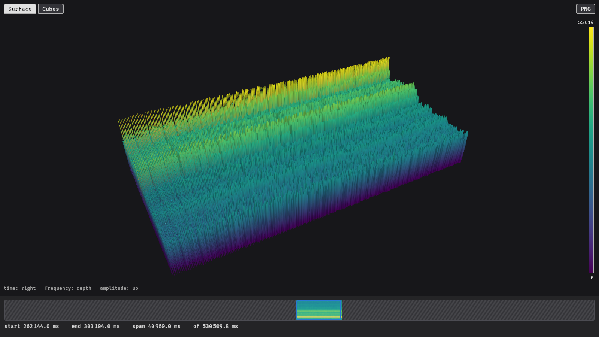

# glowfish

glowfish is a fast viewer for QASS measurement files from the Analyzer4D software. It shows
spectrograms as 3D surfaces or cubes and time signals as line plots. It stays responsive with
files of many gigabytes and on older hardware, and it never hides what is in the data: short
peaks and gaps stay visible at every zoom level.



- **Spectrograms in 3D:** time runs to the right, frequency into the depth and the amplitude
  upwards. Switch between a connected surface and one column per cell.
- **Large files:** glowfish only reads the parts of a file you look at and loads in the
  background. A timeline at the bottom shows the whole file and the displayed time window.
- **Whole folders:** open a folder to choose between its measurements, channels and files.
- **Image export:** render a file or a time window of it to a PNG for reports, without opening
  a window.
- **Configurable:** display, scaling, controls and every text of the interface can be changed
  in a configuration file.

## Installation

glowfish is currently built from source.

### Requirements

- A graphics card with Vulkan (Linux, Windows), DirectX 12 (Windows) or Metal (macOS) support.
  Image exports render on the graphics card too.
- [git](https://git-scm.com) and the Rust toolchain, version 1.97.1 or newer, installed with
  [rustup](https://rustup.rs).
- Build tools for your operating system:
  - **Linux:** the development packages Bevy needs:

    ```sh
    # Debian / Ubuntu
    sudo apt install pkg-config libasound2-dev libudev-dev libwayland-dev libxkbcommon-dev libx11-dev
    # Arch Linux
    sudo pacman -S pkgconf alsa-lib systemd-libs wayland libxkbcommon libx11
    ```

  - **Windows:** the Visual Studio C++ Build Tools; the rustup installer offers to install
    them.
  - **macOS:** the Xcode command line tools: `xcode-select --install`.

### Building

```sh
git clone https://github.com/OWNER/glowfish.git
cd glowfish
cargo install --locked --path crates/cli
```

This builds an optimized `glowfish` binary and installs it into the `bin` folder of Cargo
(`~/.cargo/bin` on Linux and macOS, `%USERPROFILE%\.cargo\bin` on Windows), which rustup adds
to your `PATH`. The first build takes several minutes. Check the installation with:

```sh
glowfish --version
```

To update, pull the latest changes and run the `cargo install` command again.

## Usage

```text
glowfish [OPTIONS] [PATH]                       open a file or folder in the viewer
glowfish export <FILE> -o <PNG> [OPTIONS]       render FILE to a PNG
glowfish config [--default | --init]            show, print or create the configuration
```

`glowfish --help` and `glowfish <command> --help` list all options.

### Opening a file or folder

```sh
glowfish p000665c0b01.000      # a measurement file
glowfish measurements/         # a folder: choose measurement, channel and file in a panel
glowfish                       # without a path, a file dialog opens
```

Folders include files in subfolders; `--no-recursive` only reads the files directly in the
folder.

In the viewer:

| Action | Mouse |
| --- | --- |
| Move along time | left button drag |
| Rotate the view | right button drag |
| Zoom the camera | wheel |
| Zoom in time | Ctrl + wheel |
| Move the time window (timeline) | left button drag |
| Select a new time window (timeline) | right button drag |
| Show the whole file (timeline) | double click |

### Exporting images

```sh
glowfish export p000665c0b01.000 -o burst.png --start 298409 --end 298745 --mode cubes
```

renders the time window from 298 409 ms to 298 745 ms as cubes. `--size 3840x2160` sets the
image size (default 1920x1080).

### View options

These options work for the viewer and for `export` and override the configuration file.

| Option | Values |
| --- | --- |
| `--mode <MODE>` | `surface`, `cubes` |
| `--cells <CELLS>` | `max`: columns up to the maximum; `range`: boxes from minimum to maximum |
| `--max-cells <N>` | most cells drawn; lower it on slow hardware |
| `--axes`, `--no-axes` | show or hide axes with ticks and labels |
| `--scaling <MODE>` | `linear`, `auto`, `fixed` (with `--min` and `--max`) |
| `--start <MS>`, `--end <MS>` | displayed time window in ms from the start of the file |
| `--yaw`, `--pitch`, `--distance` | camera position |
| `--threads <N>`, `--cache-mb <MIB>` | loading threads and memory for loaded data |
| `--config <FILE>` | use another configuration file |

### Configuration

```sh
glowfish config            # where the configuration file is and whether it exists
glowfish config --init     # create it with all defaults and comments
```

The [configuration reference](docs/configuration.md) describes every setting, including
translations of the interface. More details on the viewer, folders and exports are in the
[documentation](docs/index.md).

## Opening files from the file manager

QASS measurement files have no common file extension; they are recognized by their first 8
bytes, `qassdata`. The steps below add glowfish to the right-click menu of your file manager,
so files open without typing a command. They assume glowfish was installed with
`cargo install` as above.

### Linux

Linux desktops recognize files by their content, so glowfish can become the default
application for measurement files only.

1. Define a file type for the files that start with `qassdata`:

   ```sh
   mkdir -p ~/.local/share/mime/packages
   cat > ~/.local/share/mime/packages/qass.xml <<'EOF'
   <?xml version="1.0" encoding="UTF-8"?>
   <mime-info xmlns="http://www.freedesktop.org/standards/shared-mime-info">
     <mime-type type="application/x-qass">
       <comment>QASS measurement file</comment>
       <magic priority="80">
         <match type="string" offset="0" value="qassdata"/>
       </magic>
     </mime-type>
   </mime-info>
   EOF
   update-mime-database ~/.local/share/mime
   ```

2. Register glowfish as an application for that type:

   ```sh
   mkdir -p ~/.local/share/applications
   cat > ~/.local/share/applications/glowfish.desktop <<EOF
   [Desktop Entry]
   Type=Application
   Name=glowfish
   Comment=View QASS measurement files
   Exec=$HOME/.cargo/bin/glowfish %f
   Terminal=false
   MimeType=application/x-qass;
   Categories=Science;Viewer;
   EOF
   update-desktop-database ~/.local/share/applications
   ```

   To open folders with glowfish as well, use `MimeType=application/x-qass;inode/directory;`.
   glowfish then appears under *Open With* for folders, without becoming their default.

3. Make glowfish the default for measurement files (optional):

   ```sh
   xdg-mime default glowfish.desktop application/x-qass
   ```

### Windows

Windows decides by file extension only, so glowfish is added to the right-click menu of all
files. Run these commands in a **Command Prompt** (`cmd`, not PowerShell); they only change
your user account and need no administrator rights:

```bat
reg add "HKCU\Software\Classes\*\shell\glowfish" /ve /d "Open with glowfish" /f
reg add "HKCU\Software\Classes\*\shell\glowfish" /v Icon /d "%USERPROFILE%\.cargo\bin\glowfish.exe" /f
reg add "HKCU\Software\Classes\*\shell\glowfish\command" /ve /d "\"%USERPROFILE%\.cargo\bin\glowfish.exe\" \"%1\"" /f
```

To open folders as well, run the same commands with `Directory` in place of `*`. On
Windows 11 the entry is under *Show more options*. To remove it again:

```bat
reg delete "HKCU\Software\Classes\*\shell\glowfish" /f
```

glowfish is a command line program, so a console window opens next to the viewer; closing it
closes glowfish.

### macOS

macOS also decides by file extension, and only lists app bundles under *Open With*. A Quick
Action adds glowfish to the right-click menu of all files and folders instead:

1. Open **Automator** and create a new document of type **Quick Action**.
2. At the top, set *Workflow receives current* to **files or folders** in **Finder**.
3. Add the action **Run Shell Script** (search for it on the left), set *Pass input* to
   **as arguments** and replace the script with:

   ```sh
   for f in "$@"; do
     "$HOME/.cargo/bin/glowfish" "$f" > /dev/null 2>&1 &
   done
   ```

4. Save it as **Open with glowfish**.

Right-click a file or folder in Finder and choose **Quick Actions → Open with glowfish**. The
first time, macOS may ask whether glowfish may access the folder.

## Roadmap

- **File selection for folders:** a better interface for finding and selecting files when a
  whole folder is opened.
- **Markers:** set markers in the view to label points in time and frequency.
- **Highlights:** highlight regions of interest in the data.

## Development

The repository is a Cargo workspace:

| Crate | |
| --- | --- |
| `crates/qass-files` | reads QASS measurement files |
| `crates/qass-metadata-cache` | indexes the metadata of the files of a folder |
| `crates/glowfish-data` | loading, downsampling and caching, independent of the interface |
| `crates/glowfish-viz` | the 3D and 2D view and the timeline, built with [Bevy](https://bevy.org) |
| `crates/glowfish-app` | the folder panel |
| `crates/cli` | the `glowfish` command |

```sh
cargo run -p cli -- <FILE>          # run the viewer from the repository
cargo clippy --all-targets          # lint
cargo test                          # tests
```

## License

glowfish is licensed under the [GNU General Public License v3.0](LICENSE). The bundled Fira
Mono font is licensed under the
[SIL Open Font License 1.1](crates/glowfish-viz/assets/fonts/FiraMono-OFL.txt).
