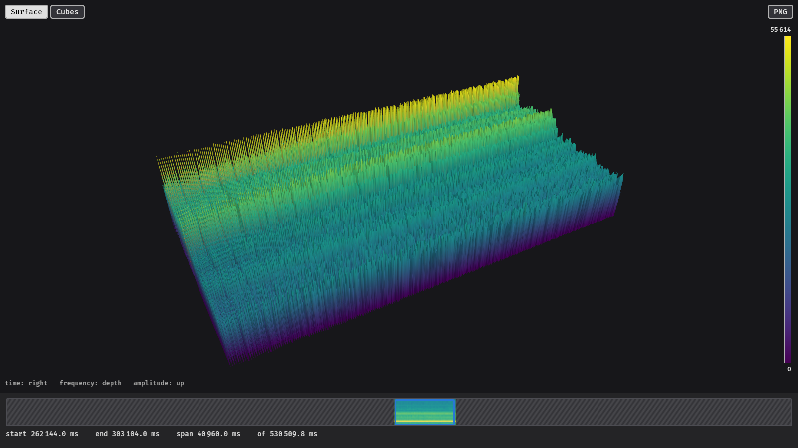

# glowfish

glowfish shows measurement files from the Analyzer4D software: spectrograms as 3D surfaces or
cubes, time signals as line plots. It is built to stay fast with files of many gigabytes and on
older hardware, and to never hide what is in the data: small peaks and gaps stay visible at
every zoom level.



## Quick start

Open a file in the viewer:

```sh
glowfish p000665c0b01.000
```

Without a file, glowfish opens a file dialog.

Export a PNG without opening a window, here the time window from 298.4 s to 298.7 s as cubes:

```sh
glowfish export p000665c0b01.000 -o burst.png --start 298409 --end 298745 --mode cubes
```

Create a configuration file to change the defaults:

```sh
glowfish config --init
```

## What is shown

Spectrograms
:   Time runs to the right, frequency into the depth and the amplitude upwards. The colour
    follows the amplitude as well. Choose between a **surface** and **cubes**, see
    [The viewer](usage/viewer.md#surface-and-cubes).

Time signals
:   A flat plot of amplitude over time, see [Signals](usage/viewer.md#signals).

## Next steps

- [Installation](installation.md): build glowfish and what it needs to run
- [The viewer](usage/viewer.md): controls, the timeline and how data is loaded
- [Exporting images](usage/export.md): PNG files for reports
- [Configuration](configuration.md): all settings of the configuration file
