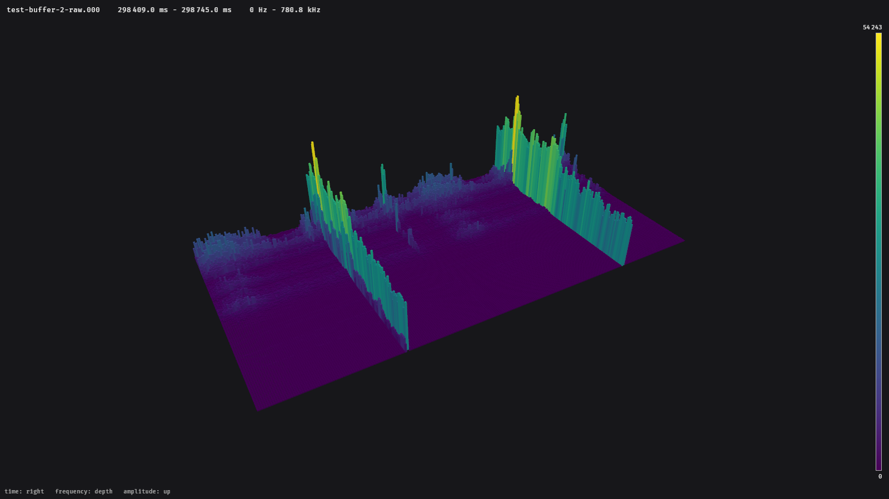

# Exporting images

```sh
glowfish export <FILE> -o <PNG> [--size WIDTHxHEIGHT] [OPTIONS]
```

renders a file, or a time window of it, into a PNG file. No window opens; the picture is
rendered on the graphics card and written directly.

An export contains the plot, the colour legend, a title with the file name, the time range and
the frequency range, and the axis labels. Buttons and the timeline are left out.



## Examples

The whole file with the defaults (1920 × 1080 pixels, surface):

```sh
glowfish export p000665c0b01.000 -o overview.png
```

A time window from 298 409 ms to 298 745 ms as cubes from minimum to maximum, in 4K:

```sh
glowfish export p000665c0b01.000 -o burst.png \
  --start 298409 --end 298745 --mode cubes --cells range --size 3840x2160
```

The same values on the same scale for several files, so that the pictures can be compared:

```sh
for f in measurements/*.000; do
  glowfish export "$f" -o "$(basename "$f" .000).png" --min 0 --max 60000
done
```

A view from a different angle:

```sh
glowfish export p000665c0b01.000 -o side.png --yaw -60 --pitch 25 --distance 18
```

## Options

| Option | |
| --- | --- |
| `-o`, `--output <PNG>` | file to write; must end with `.png` |
| `--size <WIDTHxHEIGHT>` | size in pixels, up to 16384 × 16384 (default from [`export`](../configuration.md#export), 1920x1080) |
| `--start <MS>`, `--end <MS>` | time window in milliseconds from the start of the file |

All other [view options](command-line.md#view-options) work as in the viewer. Labels grow with
the image: they have the same size relative to the picture at any resolution.

!!! note
    glowfish waits until the time window is completely loaded before it writes the picture.
    For a long time window of a large file on a slow disk this can take a while; after five
    minutes the export gives up with an error.
