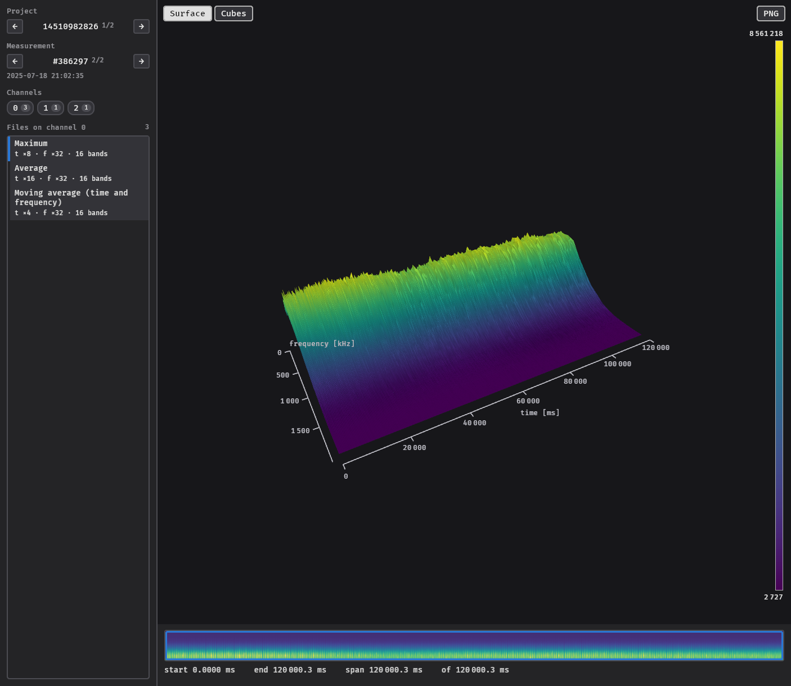

# Opening a folder

```sh
glowfish <FOLDER> [OPTIONS]
```

opens all measurement files of a folder. A panel on the left lists them; the file selected in
the panel is shown in the view next to it.



glowfish reads the folder in the background and shows *Reading ...* until it is done. Files
that are not measurement files are skipped. By default, files in subfolders are included as
well; `--no-recursive` (or `metadata.recursive = false` in the
[configuration](../configuration.md#metadata)) only reads the files directly in the folder.

## The panel

**Project**
:   Only shown when the folder contains files of more than one project. The arrows switch
    between the projects.

**Measurement**
:   All files with the same process number belong to one measurement. The arrows switch
    between the measurements of the project, sorted by process number; glowfish starts with
    the latest one. Below the number is the time of the measurement.

**Channels**
:   Every channel used in the project. The small number on a channel is the number of files of
    the selected measurement on it; channels without files are greyed out. Click a channel to
    list its files.

**Files on channel**
:   The files of the selected measurement on the selected channel, raw data first. Each file
    shows its data type and below it how it is compressed: `t ×8` combines 8 spectra, `f ×32`
    combines 32 frequency bands, `16 bands` is the number of frequency bands that remain.
    Click a file to show it. The mouse wheel scrolls the list.

## Comparing files

Switching to another file of the **same measurement** keeps the time window, so the same moment
can be compared in different channels or data types. Switching to another measurement or
project shows the whole file.

When switching measurements, glowfish keeps the channel and the kind of file (data type and
compression) if the new measurement has one like it.

## Large folders

Reading a folder only reads the headers of the files, which is fast even for many files.
With a [database file](../configuration.md#metadata), the metadata is kept between runs.
