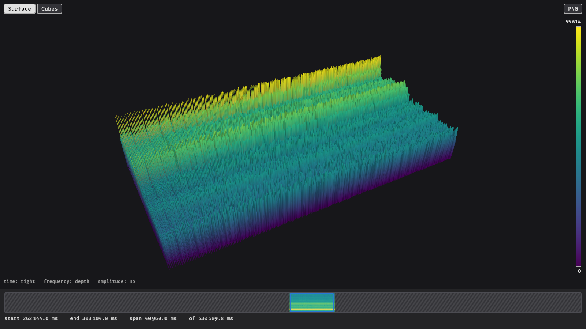
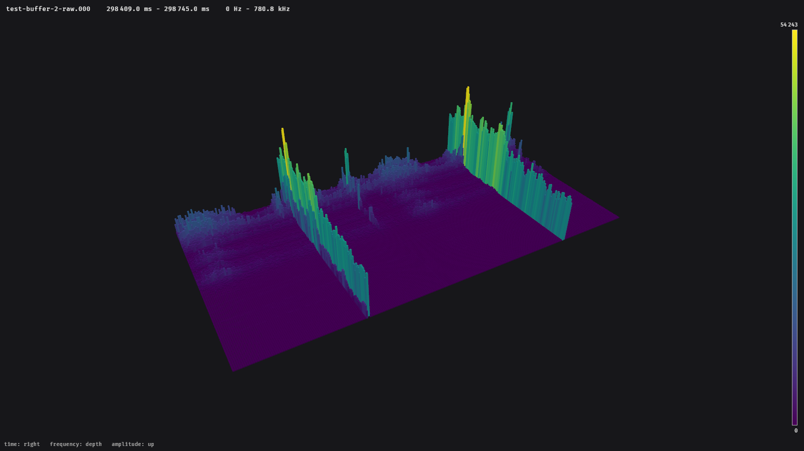
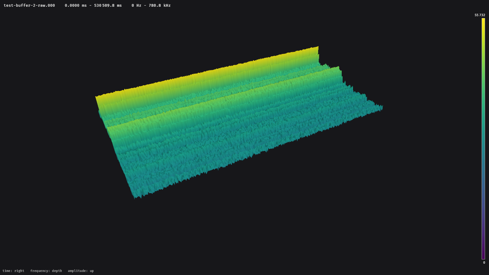
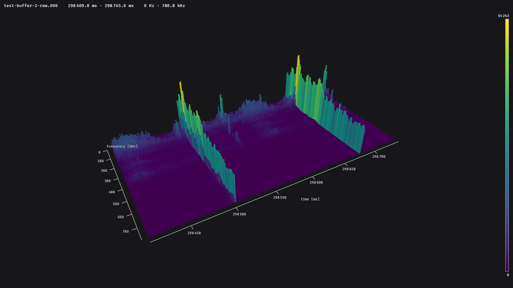
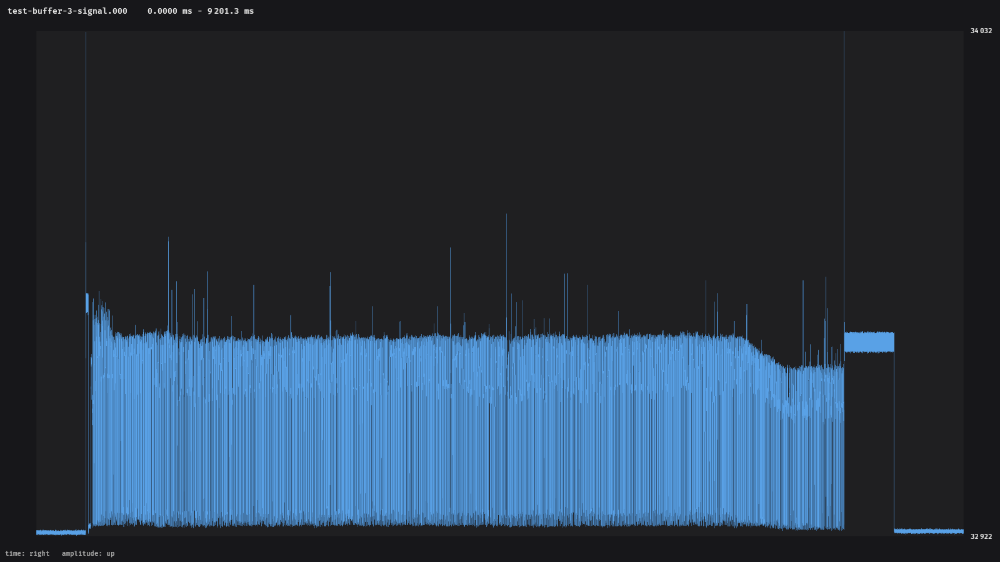

# The viewer

```sh
glowfish <FILE> [OPTIONS]
```

opens a measurement file. Without a file, a file dialog opens. All
[command line options](command-line.md) and [settings](../configuration.md) apply.



The window has three parts:

- the **view** with the data, filling the window,
- **controls** on top of it: the display mode on the top left, the PNG button on the top right
  and the colour legend on the right,
- the **timeline** at the bottom, an overview of the whole file with the displayed time window.

The viewer only draws a new picture when something changes, so it does not use the graphics
card while you look at the data.

## Controls

The default controls work like a map: the data moves under a fixed camera.

| Action | Mouse | |
| --- | --- | --- |
| Move along time | ++left-button++ drag | the data follows the cursor |
| Rotate the view | ++right-button++ drag | around the vertical axis and up/down |
| Zoom the camera | wheel | |
| Zoom in time | ++ctrl++ + wheel | around the time under the cursor |

Panning only moves in time; the frequency axis always stays in view. The buttons for panning
and rotating can be swapped or moved to the middle button in the
[configuration](../configuration.md#controls).

Below the controls, the **readout** shows the time, frequency and value under the cursor. A
cell of the view usually stands for many spectra; the readout then shows the maximum and the
minimum of all of them.

## The timeline

The timeline at the bottom shows the whole file. The blue frame marks the time window that is
displayed; start, end and length are written below it.

| Action | Mouse |
| --- | --- |
| Move the time window | ++left-button++ drag |
| Select a new time window | ++right-button++ drag |
| Show the whole file | double click with ++left-button++ |

A left click outside of the frame moves the window there, centred on the click. A right
click without dragging does nothing: a new window is only selected once the mouse has moved a
few pixels.

**Hatched areas** have not been loaded yet. glowfish only reads the parts of a file that you
look at: opening a short time window of a large file is fast, and the timeline fills in as you
move around. Areas that have been loaded once are kept in memory (see
[`loading.cache_mb`](../configuration.md#loading)).

## Surface and cubes

Switch with the buttons on the top left, or start in a mode with `--mode surface` or
`--mode cubes`.

**Surface**
:   A connected surface through all cells. Light on the graphics card, good for overviews.

**Cubes**
:   One column per cell. Shows the cells as they are, with clear edges between them.

With `--cells range` (or `view.cells = "range"`), cubes span from the **minimum** to the
**maximum** of their cell instead of standing on the ground. This shows short gaps as well as
short peaks:



## How large files are shown

A file can hold millions of spectra, far more than can be drawn. glowfish combines neighbouring
spectra (and frequency bands) into cells and keeps the **minimum and the maximum** of every
cell. Nothing is averaged away: a single short peak still reaches its full height in an
overview of the whole file.

How many cells are drawn is set by [`view.max_cells`](../configuration.md#view). The default of
65 536 gives 512 cells along time and 128 along frequency.



When you move or zoom, the data that is already loaded is shown immediately; the rest is loaded
in the background and a yellow bar on top of the timeline shows the progress. A new move
cancels loading that is no longer needed.

## Axes

With `--axes` (or `view.axes = true` in the [configuration](../configuration.md#view)), the
view gets axes with ticks and labels:

- spectrograms: **time** in ms along the front edge and **frequency** along the left edge of
  the data, on the ground,
- signals: **time** in ms below and **amplitude** left of the plot.



The ticks follow the displayed time window, so they update while you pan and zoom. The labels
are always drawn upright and facing you, whatever the angle of the view. `--no-axes` hides the
axes when they are switched on in the configuration.

## Colours and scaling

The colour and the height both show the amplitude. The legend on the right shows which values
the colours stand for. Which range of values fills the height is set by the
[scaling](../configuration.md#scaling):

- `auto` (default): from the smallest to the largest value that is displayed,
- `linear`: from 0 to the largest value the file can hold,
- `fixed`: a range you choose, e.g. to compare several files.

## Signals

Time signals are drawn as a flat plot of amplitude over time. Each column of the plot covers the
lowest and highest sample at that time, so peaks remain visible in long recordings.



In a signal plot, the wheel zooms in time around the cursor; ++ctrl++ is not needed.
Panning and the timeline work as for spectrograms.

## Saving a picture

The **PNG** button saves the window as it is, including the controls, to the current
directory. The file is named after the measurement file and the displayed rows, e.g.
`p000665c0b01_000_3642696-3646792.png`.

For pictures without controls, in any size, use [`glowfish export`](export.md).
